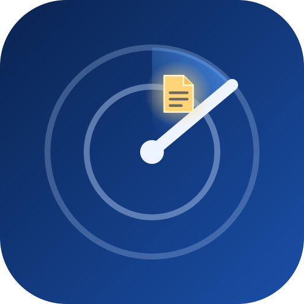
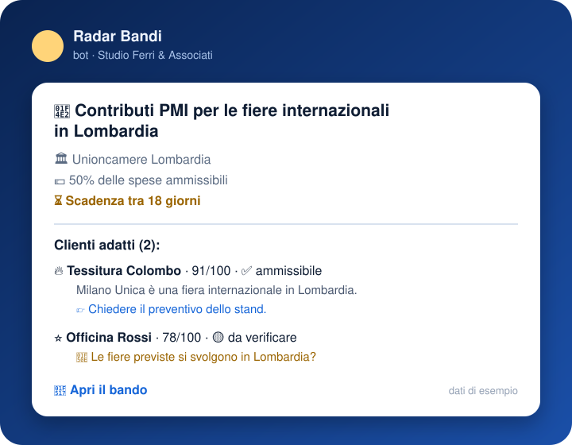
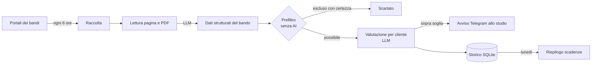

<h1 align="center">Radar Bandi</h1>

<b>I bandi giusti per i clienti del tuo studio, ogni settimana.</b>

Radar Bandi legge ogni giorno i portali dei bandi pubblici, capisce a chi si rivolge ogni bando e avvisa su Telegram i commercialisti e i consulenti quando un bando è adatto a uno dei loro clienti: con il punteggio, il motivo, cosa resta da verificare e il prossimo passo.

> 🇬🇧 *Radar Bandi monitors Italian public grant portals, reads every call with an LLM and tells accounting firms, on Telegram, which of their clients can apply and why.*

---

## ✨ Cosa fa

- **Raccoglie** i bandi aperti da Regione Lombardia (Bandi e Servizi), Unioncamere Lombardia e MIMIT, scartando in partenza gare d'appalto, concorsi e procedimenti amministrativi.
- **Legge** la pagina del bando e, se serve, il PDF allegato, e ne ricava beneficiari, dimensioni d'impresa ammesse, territorio, settori e codici ATECO, spese ammissibili, contributo massimo, intensità dell'aiuto, modalità e scadenza.
- **Confronta** ogni bando con i clienti dello studio: sede, dimensione, tipo (impresa, startup, professionista), settore e soprattutto i **progetti in vista**.
- **Avvisa** lo studio con un messaggio per bando e, ogni lunedì, con il riepilogo delle scadenze dei prossimi 30 giorni.
- **Importa i clienti da Excel**: lo studio compila un modello (o manda il proprio elenco) e i profili vengono creati in un comando.

## 🧭 Come funziona

## 🛡 Affidabilità prima di tutto

L'AI segnala, lo studio decide. Per questo ogni risultato passa da regole fisse:

- **Niente importi inventati**: contributi, percentuali e codici ATECO vengono mostrati solo se compaiono alla lettera nel testo del bando; le date devono essere valide e plausibili.
- **Dubbi dichiarati**: se un requisito non si ricava dal profilo del cliente, l'avviso lo scrive in "Da verificare" invece di darlo per scontato.
- **Punteggi tenuti a bada**: un cliente che non rispetta un requisito esplicito non supera mai la soglia di notifica, e nemmeno un bando che non finanzia nessuno dei suoi progetti.
- **Prefiltro deterministico**: regione, dimensione e tipo di beneficiario chiaramente incompatibili vengono esclusi senza chiamare l'AI. Un dato mancante non esclude mai.
- **Contenuti del web trattati come dati**: le pagine scaricate sono isolate nel prompt e le istruzioni al loro interno vengono ignorate.

## 🛠 Tecnologie

| Area | Tecnologie |
|---|---|
| Linguaggio | Python 3.12, asyncio, Pydantic v2 (output strutturati validati), uv |
| Raccolta | httpx con retry e backoff, BeautifulSoup, ricerca paginata via POST, feed RSS, pypdf |
| AI | Claude (Anthropic API, structured outputs) oppure modelli locali con Ollama, con modalità ibrida e circuit breaker |
| Dati | SQLite: ogni bando letto una volta, ogni coppia bando/cliente valutata una volta (di nuovo solo se il profilo cambia), ogni avviso inviato una volta |
| Notifiche | Bot Telegram unico, una chat per studio, messaggi HTML entro i limiti di Telegram |
| Qualità | 29 test automatici (pipeline completa con LLM simulato, scraper, regole, import Excel), ruff, mypy strict |
| Deploy | Docker, utente non root, configurazione da variabili d'ambiente |

## 📍 Stato

MVP funzionante, in prova con i primi studi. Fonti attive: **Lombardia** e misure **nazionali**; altre regioni e le Camere di commercio sono le prossime. Una dashboard web per gestire clienti e pratiche è in progettazione.

Sei un commercialista o un consulente e vuoi provarlo con i tuoi clienti? Contattaci dal profilo GitHub [@markdeca](https://github.com/markdeca).

---

🔒 *Il codice sorgente è privato. È disponibile su richiesta per collaboratori e partner.*
